<div align="center">



<br/>

[](https://www.linkedin.com/in/khushneet)
[](mailto:khushneetgirgla@gmail.com)
<!-- RESUME BADGE: upload resume.pdf to this repo, then uncomment:
[](https://github.com/KhushneetKaur/KhushneetKaur/raw/main/resume.pdf)
-->

</div>

---

## `$ whoami`

```yaml
name:          Khushneet Kaur
role:          Full-stack developer, CSE final year
campus:        GZSCCET, MRSPTU Bathinda
shipped:       CGPA Pulse (live, real users)
learning:      DSA, System Design
open_to:       SDE / Full-Stack roles
easter_egg:    debugs code before the skincare routine
```

- 🛠️ Solo full-stack dev. I design, build, ship and maintain things end to end.
- 🎯 I build from real gaps. If a problem keeps annoying students, I fix it.
- 🧴 Side process: clean-ingredient skincare. I read labels like stack traces.

---

## `$ cat tech_stack.log`

<table align="center">
<tr>
<td align="center" width="25%"><b>⚙️ Languages</b><br/><br/>
</td>
<td align="center" width="25%"><b>🖥️ Frontend</b><br/><br/>
</td>
<td align="center" width="25%"><b>🗄️ Backend</b><br/><br/>
</td>
<td align="center" width="25%"><b>🔧 Tools</b><br/><br/>
</td>
</tr>
</table>

---

## `$ ./run featured_project.sh`

<div align="center">

### 📟 CGPA Pulse: a PWA that finally does the math

[](https://github.com/KhushneetKaur/cgpa-pulse)
<!-- LIVE DEMO BADGE: replace YOUR_URL, then uncomment:
[](YOUR_URL)
-->

</div>

<!-- SCREENSHOTS: save 2-3 phone screenshots in assets/screenshots/ (leaderboard.png, result.png, install.png), then uncomment:
<div align="center">
  
  
  
</div>
-->

<!-- IMPACT LINE: add a real number here, e.g. "**Used by N students across M branches.**" -->

**The problem.** University result PDFs show SGPA per semester but never CGPA, so students did manual, error-prone math every single semester.

**The fix.**

- Preloaded subject lists across Engineering and University Departments (B.Pharm, Pharm.D, M.Pharm)
- Automatic SGPA → CGPA calculation, plus predictor and target modes
- Mandatory leaderboard with Overall and Branch tabs
- Installable PWA that works like an app on your phone

**Under the hood.**

| Layer | Stack |
|---|---|
| Frontend | React 18 + Vite, hosted on Vercel |
| Backend | Node.js + Express, hosted on Render |
| Database | MongoDB Atlas |
| Grading engine | Scheme-aware: Engineering's numeric GPA alongside Pharmacy's O/A/B/C/D/F + percentage system, including Pharm.D's 5-year annual structure |

**Production fixes I'm proud of.** Squashed an iOS login loop, removed a dead CSRF middleware that was adding latency, and cleaned up duplicate routes.

---

## `$ ls ~/more_projects`

### 💬 Business Class FAQ Bot

A free FAQ chatbot for MRSPTU's Business Class course, which serves 75 colleges and 13,000+ students. Questions that used to flood WhatsApp and phone calls now get instant, consistent answers from one shared link. The FAQ lives in a Google Doc that the course in-charge can edit without touching any code. Deployed on Vercel.

<!-- Add a repo or live link: [View it →](YOUR_URL) -->

---

## `$ ls ~/beyond_code`

I like building structures and communities from scratch, not just apps.

- **President, Training & Placement Cell, MRSPTU**: leading eight sub-teams (HR, Alumni Relations, Promotion & Networking, Career Guidance, Hackathon, Design, Social Media, LinkedIn)
- **Co-Founder & President, MRSPTU Music Club**: built the full organizational hierarchy from zero
- **Former VP, MRSPTU Student Literary Club**

---

## `$ now`

- 🧩 Grinding DSA and System Design for placement season
- 🚀 Improving CGPA Pulse based on what students actually ask for
- 🏛️ Running the T&P Cell: more companies, better student prep

---

<div align="center">

<picture>
  <source media="(prefers-color-scheme: dark)" srcset="https://raw.githubusercontent.com/KhushneetKaur/KhushneetKaur/output/github-contribution-grid-snake-dark.svg" />
  <source media="(prefers-color-scheme: light)" srcset="https://raw.githubusercontent.com/KhushneetKaur/KhushneetKaur/output/github-contribution-grid-snake.svg" />
  
</picture>

<br/>

### Hiring for SDE / Full-Stack, or want to build something together?

📫 [khushneetgirgla@gmail.com](mailto:khushneetgirgla@gmail.com) · 💼 [LinkedIn](https://www.linkedin.com/in/khushneet)

</div>

